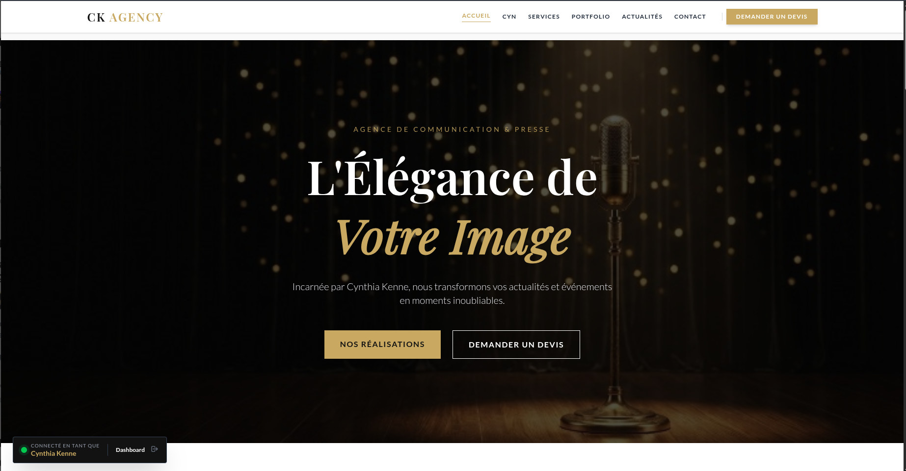

# 🌟 CK Event Agency

> Plateforme web premium pour l'agence de communication et d'événementiel de prestige.

[](https://laravel.com)
[](https://livewire.laravel.com)
[](https://tailwindcss.com)
[](https://filamentphp.com)



---

## 🎯 À Propos

**CK Event Agency** est une plateforme web élégante et performante conçue pour l'agence de communication et de presse de **Cynthia Kenne**. 

Elle combine une **architecture technique moderne** (TALL Stack) avec un **design luxe Noir & Or** pour valoriser l'information et l'événementiel de prestige.

---

## ⚡ Démarrage Rapide (5 minutes)

### ✅ Prérequis
- PHP 8.2+
- Composer
- Node.js 18+
- MySQL ou SQLite

### 🚀 Installation

```bash
# 1️⃣ Cloner le projet
git clone https://github.com/Rudiger123/ck-event-agency.git
cd ck-event-agency

# 2️⃣ Installer les dépendances
composer install
npm install

# 3️⃣ Configurer l'environnement
cp .env.example .env
php artisan key:generate

# 4️⃣ Initialiser la base de données
php artisan migrate --seed

# 5️⃣ Lancer les serveurs
php artisan serve      # Terminal 1 - http://localhost:8000
npm run dev            # Terminal 2 - Vite dev server
```

**Connexion Admin :**
- URL : http://localhost:8000/admin
- Identifiants définis dans les seeders

---

## 📋 Fonctionnalités

### 🌐 **Frontend Client**
| Fonctionnalité | Description |
|---|---|
| 🏠 **Landing Page** | Présentation immersive de l'agence avec vision et expertise |
| 📰 **Blog Intelligent** | Média riche avec affichage hiérarchisé (Vidéo → Audio → Image) |
| 🎨 **Portfolio** | Galeries haute résolution avec Lightbox interactif |
| ⏳ **Timeline** | Parcours professionnel interactif |
| 💬 **Témoignages** | Slider dynamique de preuve sociale |
| 📧 **Newsletter** | Abonnement avec gestion en admin |
| 📝 **Formulaires** | Demandes de devis et messages de contact |

### 🛠️ **Back-Office Admin**
| Fonctionnalité | Description |
|---|---|
| 📊 **Dashboard** | Stats en temps réel, graphiques d'activité |
| 💼 **Gestion Devis** | Réception et envoi de propositions (PDF) |
| ✏️ **Modération** | Gestion de tous les contenus (articles, événements, commentaires) |
| ⚙️ **Réglages** | Contrôle dynamique : coordonnées, réseaux, SEO |
| 👥 **Utilisateurs** | Gestion des rôles et permissions |

---

## 🛠️ Stack Technique

| Couche | Technologie |
|---|---|
| **Backend** | Laravel 11 (PHP 8.2+) |
| **Frontend** | Livewire 3 + Alpine.js, Tailwind CSS 4.0 |
| **Admin** | Filament PHP v3 |
| **Base de données** | MySQL (production) / SQLite (local) |
| **Médias** | Spatie MediaLibrary |
| **Traduction** | Spatie Laravel Translatable |
| **Build** | Vite + npm |

---

## 📁 Structure du Projet

```
ck-event-agency/
├── app/
│   ├── Http/              # Contrôleurs & Middleware
│   ├── Livewire/          # Composants réactifs (logique frontend)
│   ├── Filament/          # Ressources admin
│   ├── Models/            # Modèles de données
│   ├── Mail/              # Notifications email
│   ├── Observers/         # Event listeners
│   └── Services/          # Logique métier
├── resources/
│   ├── views/             # Blade templates
│   └── js/css/            # Assets
├── public/
│   ├── images/            # Médias statiques
│   └── storage/           # Uploads utilisateurs
├── database/
│   ├── migrations/        # Schéma base de données
│   └── seeders/           # Données de test
├── docs/                  # Documentation
└── tests/                 # Tests unitaires & fonctionnels
```

---

## 🔧 Commandes Utiles

```bash
# Développement
php artisan serve              # Démarrer le serveur Laravel (port 8000)
npm run dev                    # Démarrer Vite en mode dev
php artisan migrate            # Exécuter les migrations

# Admin Filament
php artisan make:filament-resource Post  # Créer une nouvelle ressource

# Testing
php artisan test               # Lancer tous les tests
php artisan test tests/Feature # Tester un dossier spécifique

# Production
npm run build                  # Compiler les assets (minifiés)
php artisan migrate:fresh --seed  # Reset DB + seeders

# Cache & Optimization
php artisan cache:clear       # Vider le cache
php artisan view:cache        # Compiler les vues
```
## 👤 Crédits & Vision
Inspiration & Fondatrice : Cynthia Kenne
Développement : [Ton Nom ou Pseudo GitHub]
Mission de l'Agence : Valoriser l'information et l'événementiel à travers une communication humaine et prestigieuse.
## ⚖️ Licence
Ce projet est la propriété exclusive de CK Event Agency. Toute reproduction ou utilisation commerciale sans autorisation est interdite.
